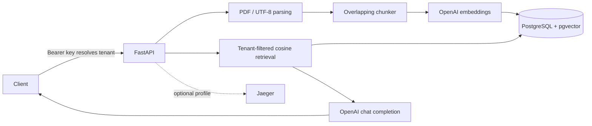

# Enterprise RAG System

A modular, tenant-scoped retrieval-augmented generation API built with FastAPI, PostgreSQL/pgvector, OpenAI embeddings/chat completions, Docker Compose, and Alembic migrations. This repository is a deployable baseline—not a substitute for your organization's identity provider, security review, model evaluation, or operational SLOs.

## Features

- FastAPI endpoints for document ingestion, semantic chat, health/readiness, and tenant-scoped document deletion.
- PDF, Markdown, and UTF-8 text parsing; bounded uploads/chunk counts; configurable overlap chunking; pgvector cosine search and HNSW index.
- Tenant identity derived from a bearer API key mapping; tenant filters applied to all retrieval/deletion queries.
- Async PostgreSQL access, versioned migrations, upload size limits, and secret-free environment template.
- Non-root multi-stage container, dependency health checks, CI lint/tests, and optional Jaeger UI container.

## Quickstart

Requirements: Docker Engine with Compose, and an OpenAI API key for embeddings and generation.

```sh
cp .env.example .env
```

Edit `.env`: set a unique random value for `API_KEYS` using `tenant-id:long-random-secret` syntax (multiple entries separated by commas), set `OPENAI_API_KEY`, and change database/Redis credentials before any shared deployment. Keep `.env` out of Git.

```sh
docker compose up --build
```

The API listens at `http://localhost:8000`; in development, OpenAPI docs are at `/docs`. The first container startup applies Alembic migrations. Check `GET /health` for liveness and `GET /ready` for database readiness.

Example requests (replace the token):

```sh
curl -X POST http://localhost:8000/v1/documents \
  -H 'Authorization: Bearer <tenant-secret>' \
  -F 'upload=@./example.pdf'

curl -X POST http://localhost:8000/v1/chat \
  -H 'Authorization: Bearer <tenant-secret>' \
  -H 'Content-Type: application/json' \
  -d '{"query":"What does the document say?","top_k":5}'
```

The API key determines the tenant; clients cannot select a different tenant with a request header. Delete a document with `DELETE /v1/documents/{document_id}` using the same tenant's credential.

## Local development

```sh
python -m venv .venv
. .venv/bin/activate
python -m pip install -e '.[dev]'
cp .env.example .env
# Set DATABASE_URL to a reachable pgvector PostgreSQL instance and configure API_KEYS/OPENAI_API_KEY.
alembic upgrade head
uvicorn src.api.main:app --reload
```

Useful commands: `make install`, `make test`, `make lint`, `make run`, `make migrate`, `make up`, and `make down`.

## Architecture



## Configuration

See `.env.example`. `EMBEDDING_DIMENSIONS` must match the model and database vector column; the initial migration uses 768 dimensions, matching the configured OpenAI embedding request. If changing dimensions, create and deploy a migration that alters the vector column and HNSW index. `API_KEYS` maps tenant IDs to secrets, e.g. `acme:<random-secret>,contoso:<different-secret>`. Use a secret manager and rotation process in production; this simple static mapping is intended as a starter credential boundary.

The Redis and Jaeger containers are available for future cache/telemetry instrumentation; this baseline does not yet depend on Redis or emit OpenTelemetry spans. Start Jaeger with `docker compose --profile observability up`.

## Production deployment checklist

- Put the API behind TLS and an API gateway/WAF; apply request limits, rate limits, timeouts, and upload scanning.
- Replace static API key mapping with your identity provider/service-token validation and managed secret rotation; scope identities to authorized tenants.
- Use managed PostgreSQL with backups, restricted network access, TLS, and tested restore procedures. Review pgvector index sizing and query plans against real workloads.
- Configure OpenAI data-processing settings appropriate to your policy; evaluate retrieval quality, prompt injection handling, and answer/citation requirements.
- Add alerting, structured log redaction, metrics/traces, retention policy, audit events, and disaster recovery before production traffic.
- Pin base images and dependencies to audited versions, scan images/dependencies, and use protected CI deployment environments.

## Tests and repository structure

```text
src/                 API, settings, data models, ingestion, and LLM client
migrations/           Alembic configuration and initial PostgreSQL migration
tests/                Unit and API-security tests
scripts/              Database and local setup helpers
.github/workflows/     CI lint and test workflow
Dockerfile             Multi-stage non-root API image
docker-compose.yml     API, PostgreSQL/pgvector, Redis, optional Jaeger
```

Run `pytest -q` and `ruff check src tests` before submitting changes. CI runs both on pushes and pull requests.
